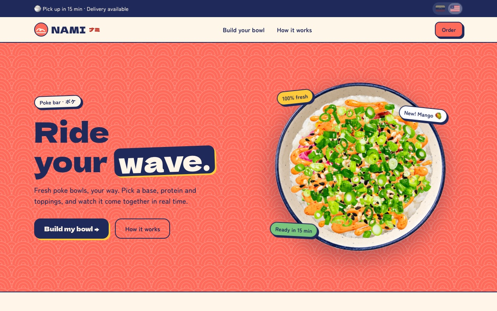
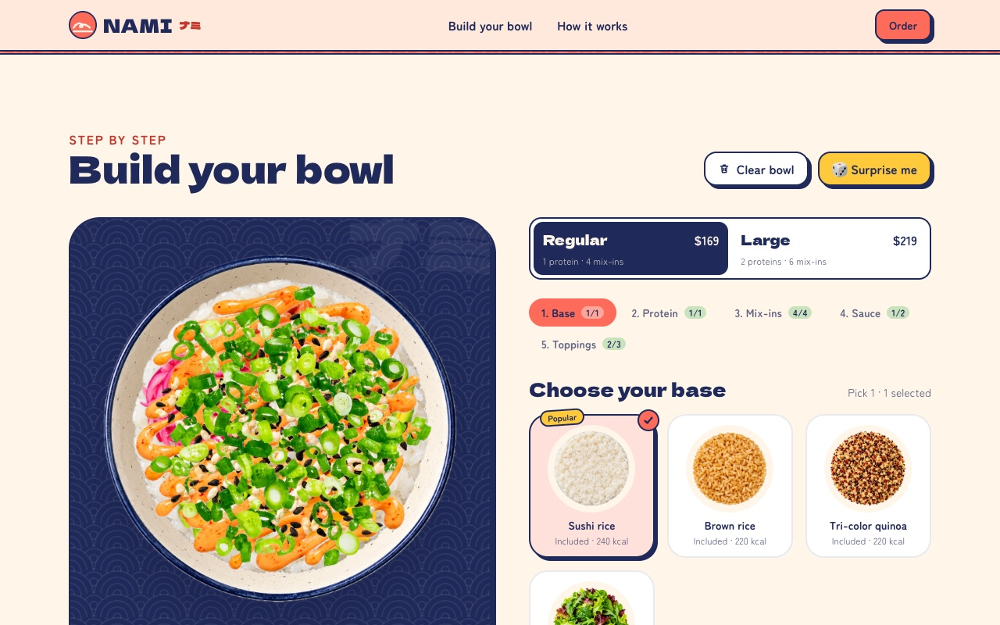
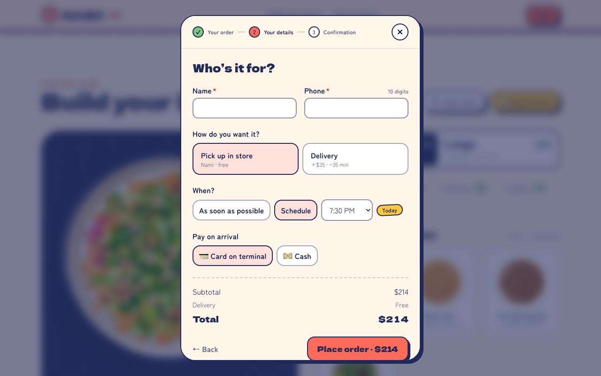
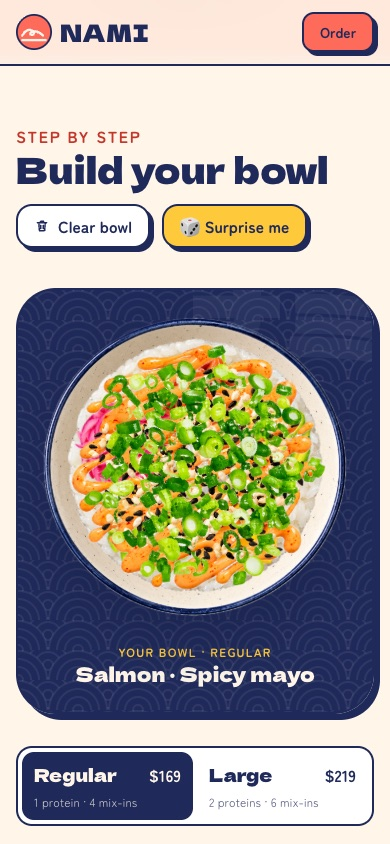

# Nami Poke Bar · Build your bowl

[](https://github.com/mgvillarreal/poke-bowl-configurator/actions/workflows/ci.yml)


A landing page with a **real-time visual poke bowl builder**. Pick a base, protein, mix-ins, sauce and toppings, and watch your bowl come together, with fluid animations and a simulated checkout.

> **Nami Poke Bar is a fictional brand** created as a portfolio concept project. Menu, prices and orders are for demo purposes only. No real order or payment is ever made.



| Builder | Checkout | Mobile |
|---|---|---|
|  |  |  |

## Features

### Bowl builder
- **Live top-down bowl** built from layers: the base fills the bowl, proteins and mix-ins drop in around the ring, sauces "draw" themselves from the center, and toppings get sprinkled on top.
- **Size rules** (Regular / Large) limit each category. When you hit a limit, a friendly message suggests upgrading. Switching to a smaller size trims the bowl automatically.
- **Live totals**: price, calories and protein are always derived from the selection, and animate as they change.
- **"Surprise me"** builds a random valid bowl. **"Clear bowl"** empties it, and only appears when there is something to clear.
- **Graceful image fallback**: every ingredient has a drawn placeholder (in its color and shape) until its photo exists, so the app always works, with or without photos.

### Simulated checkout
- **Three steps**: review your bowl, enter your details, get a confirmation.
- Quantity selector, notes for the kitchen and a price breakdown, with premium ingredients listed separately.
- **Pickup or delivery** (with delivery fee and address), **ASAP or scheduled** with real upcoming time slots, and pay-on-arrival options.
- **Inline validation**: required fields are marked, errors appear under each field, focus jumps to the first invalid field, and each error clears as soon as it's corrected.
- A confirmation screen with an animated check, an order number and an estimated time.

### Bilingual (Spanish / English)
- Switch languages by tapping a flag in the top bar. The choice is remembered on the next visit.
- **Everything is translated**: UI copy, ingredient names, notices, the checkout, the tab title and the document `lang` attribute.
- Prices and times are formatted with `Intl` for the active language.

## Quality at a glance

**Lighthouse** (production build):

| | Performance | Accessibility | Best Practices | SEO |
|---|:---:|:---:|:---:|:---:|
| Mobile | 99 | 100 | 100 | 100 |
| Desktop | 100 | 100 | 100 | 100 |

Mobile: First Contentful Paint 1.8 s · Largest Contentful Paint 1.8 s · Cumulative Layout Shift 0.002 (median of 3 runs, Lighthouse 12 default mobile throttling). Measured without the ingredient photos, which aren't in the repository yet (see [Images](#images)).

**Automated accessibility audit:** axe-core reports **0 violations** of WCAG 2.0 / 2.1 levels A and AA in 6 key states (Spanish and English home, empty bowl, and checkout review, validation errors and confirmation), on both desktop and mobile. These checks run on every push.

> Automated tools catch many, but not all, accessibility issues. These results mean no violations were *detected*, not that the site has been certified as WCAG-conformant.

## Accessibility

Built so it can be used with a keyboard and a screen reader, not only with a mouse:

- **Semantic structure**: `header`, `nav`, `main` and `footer` landmarks, with a clear heading hierarchy.
- **Correct ARIA patterns**:
  - The size selector is a `radiogroup`, and the builder steps are `tablist` / `tab` / `tabpanel`.
  - Ingredient cards are toggle buttons with `aria-pressed`, and the language flags are labeled buttons with `aria-pressed` and `lang`.
- **Accessible modal**: `role="dialog"` with `aria-modal` and a labelled title. The rest of the page becomes `inert` (no focus, hidden from screen readers), focus is trapped inside, `Esc` closes it, background scroll is locked, and focus returns to where it was on close.
- **Accessible forms**:
  - Every field has a real `<label>`.
  - Required fields use `aria-required`, plus a visually hidden "(Required)" in place of the `*`.
  - Errors are linked with `aria-invalid` and `aria-describedby`.
- **Announcements**: notices are announced through an `aria-live` region, and so are changes in quantity.
- **Color contrast**: all text meets at least 4.5:1. The brand coral is used as a background with dark text, and a darker `coral-ink` tone is used whenever coral appears as text.
- **Visible focus**: every interactive element has a high-contrast focus outline.
- **Accessible name matches the visible label** (for example, the logo link is announced as "NAMI Poke Bar, home"), so voice-control users can say what they see.
- **Reduced motion**: respects the system's `prefers-reduced-motion` setting, for both Motion animations and smooth scrolling.
- **Decorative content hidden**: decorative graphics (patterns, Japanese characters, the bowl art) are hidden from assistive technology.

## Responsive design

- Layout that adapts from phones to large desktops, with no horizontal scrolling.
- On desktop, the bowl stays in view (sticky) while you browse ingredients.
- On mobile, the checkout opens as a **bottom sheet**, the layout stacks into a single column, and the header stays compact.

## Good practices

- **Single source of truth**: the menu (`src/data/menu.ts`) defines sizes, categories and ingredients. Adding an ingredient means adding one object, its name in each language and its photo.
- **UI as a function of state**: price, nutrition, the bowl's name and its drawing are derived from the selection, never stored separately.
- **Notices stored as data, not text**: the store keeps a typed message, and it is translated when shown, so changing the language never leaves stale text behind.
- **Typed end to end** with TypeScript, linted with oxlint.
- **No layout shift from missing assets**: images are checked once and cached; placeholders render in the same space.
- **Fast first paint**: web fonts load without blocking rendering, and metric-matched fallback fonts (Arial adjusted to the brand fonts' width) keep text from jumping when the brand fonts arrive.

## Testing

End-to-end tests with **Playwright** run against the production build, in a **desktop** (1280 px) and a **mobile** (Pixel 7) viewport:

| Suite | What it covers |
|---|---|
| `e2e/builder.spec.ts` | Default bowl and price, swapping ingredients, size limits and upsell notice, upgrading/downgrading size, removing items, "Clear bowl", guiding to the missing step, "Surprise me" |
| `e2e/checkout.spec.ts` | Full pickup order, required-field validation, delivery address and fee, scheduled time slots, keyboard behavior (focus trap, `Esc`, focus return, inert background), "Build another bowl" |
| `e2e/i18n.spec.ts` | Language switch, `lang` and title, currency format, translated notices, remembered language |
| `e2e/accessibility.spec.ts` | axe-core WCAG 2.1 A/AA audit (including color contrast) in 6 key states |

Tests find elements by **role and accessible name** (`getByRole('button', { name: 'Agregar al pedido' })`), the same way assistive technology does, so a broken label also breaks a test.

**Continuous integration:** every push and pull request runs lint, type-check, build and the full Playwright suite on GitHub Actions. The HTML report is attached to each run.

## Tech stack

React 19 · TypeScript · Vite · Tailwind CSS v4 · Motion · Zustand · Playwright · axe-core

## Project structure

```
src/
  data/menu.ts            ← single source of truth: sizes, categories, ingredients
  i18n/                   ← Spanish/English messages and the language store
  lib/bowl.ts             ← derived values (price, nutrition, bowl name)
  store/bowlStore.ts      ← selection state and size rules
  components/
    bowl/Bowl.tsx         ← the animated bowl (a pure function of the configuration)
    art/                  ← real photo of each ingredient, or a drawn placeholder
    builder/              ← size toggle, steps, ingredient cards, summary
    checkout/             ← the 3-step checkout modal
    ui/                   ← logo, flags, language switch, toast, animated numbers
  sections/               ← top bar, header, hero, how it works, footer
e2e/                      ← Playwright end-to-end and accessibility tests
.github/workflows/ci.yml  ← lint, build and tests on every push
```

## Images

Ingredient photos live in `public/images/` and are generated with AI using a shared style block, so every layer has the same angle and lighting. The prompts are in [`docs/prompts-imagenes.md`](docs/prompts-imagenes.md) (in Spanish).

The photos are still being produced and optimized for the web. Until they're added to the repository, each ingredient renders as its drawn placeholder.

## Getting started

```bash
npm install
npm run dev      # http://localhost:5173
npm run build    # type-check + production build
npm run lint
npm run test:e2e     # all end-to-end tests (desktop + mobile)
npm run test:a11y    # only the accessibility audit
npm run test:e2e:ui  # Playwright UI mode
```

Locally, the tests use your installed Google Chrome; in CI they use Playwright's Chromium.

---

Made with care by **Gabriela Villarreal**.
